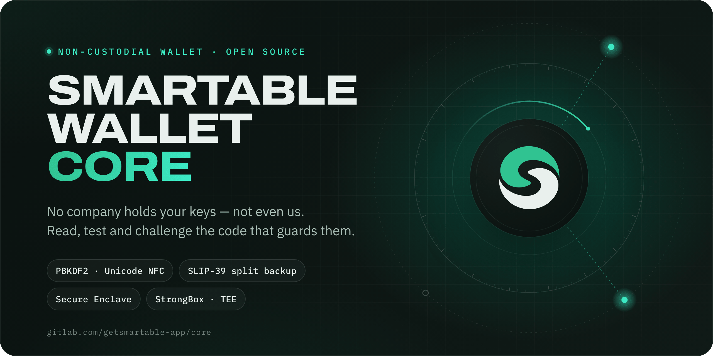

<div align="center">



<br>

[](https://gitlab.com/getsmartable-app/core/-/releases)
[](https://www.bestpractices.dev/projects/15544)
[](https://securityscorecards.dev/viewer/?uri=github.com/getsmartableapp/core)
[](LICENSE)
[](#whats-inside)

[What's inside](#whats-inside) ·
[Principles](#principles) ·
[Quick start](#quick-start) ·
[Checks and releases](#checks-and-releases) ·
[Changelog](CHANGELOG.md) ·
[Security](#security) ·
[Contributing](CONTRIBUTING.md) ·
[License](#license)

</div>

---

[Smartable Wallet](https://getsmartable.app) is a non-custodial wallet: no
company holds your keys — not even us. This repository publishes the part of
the app that keeps that promise on the phone: how a typed password becomes key
material, where secrets are stored, how the app PIN and its lockout work, how a
recovery phrase is split for backup, the hardware key the wallet is sealed
under — and, in Rust, the key core: the one place the recovery phrase's seed
and every key derived from it are held, and where a transaction is read before
it is signed. It is here so that anyone can read it, run its tests and
challenge it.

It is not a build of the app. The screens, the blockchain integrations, the
review screens and the backend stay proprietary — see
[What is not here](#what-is-not-here).

> [!IMPORTANT]
> **No independent security audit has been completed.** The code has had
> maintainer review and AI-assisted review, recorded in
> [SECURITY_REVIEW.md](SECURITY_REVIEW.md). Neither is an audit.

## What's inside

| Area | Files | What it does |
|---|---|---|
| **A typed secret becomes a key** | `crypto_utils.dart`<br>`unicode_nfc.dart` | Every password, PIN and backup passphrase is first put in one form, Unicode NFC, so the same word typed on two keyboards is the same key. Then PBKDF2-HMAC-SHA256 at 600,000 rounds — or, for a split-backup share, which can be guessed at away from the phone, Argon2id with 64 MiB of memory per guess. |
| **The recovery phrase, sealed** | `vault_keeper.dart`<br>`password_policy.dart`<br>`seed_vault.dart`<br>`password_recovery.dart` | Each recovery phrase is written under a random key of its own that nobody types, and the password only wraps that key. A password has at least twelve characters and is not mostly a pattern before anything is sealed under it. The PIN and biometric unlock each seal that key and the key imported private keys are encrypted under — never the phrase — and open only the wallet they were set up for. |
| **Encrypted or not stored** | `secure_storage.dart` | Secrets go to the platform keystore or nowhere — no plaintext fallback. A secret that cannot be decrypted is reported, never deleted. |
| **A key the app can use and cannot read** | `hardware_key.dart`<br>`key_backing.dart`<br>`native/android/main/HardwareVaultKey.kt`<br>`native/ios/main/HardwareVaultKey.swift` | The wallet's unlock keys are sealed by a key in Android Keystore — StrongBox, then the TEE — or in the iOS Secure Enclave. Which one actually holds it is reported, not assumed. |
| **The app PIN** | `pin_lock.dart`<br>`native/android/main/PinPepperKey.kt`<br>`native/ios/main/PinPepperKey.swift` | Six digits, passed first through a key in the phone's key store — HMAC in Android Keystore, StrongBox where there is one, or ECDH in the Secure Enclave — then sealed by a second device key. Every guess is a key-store operation on that phone, so the million PINs cannot be carried off to a faster machine. On Android 15 and later both keys work only while the phone is unlocked. An unlocked, rooted phone is not protected. |
| **Biometric unlock** | `quick_unlock.dart`<br>`native/*/main/HardwareVaultKey.*` | Face ID, Touch ID or a Class 3 biometric on Android, bound to a key that is released once per use. The phone's own passcode or pattern never opens the wallet. `quick_unlock.dart` decides when the option is offered at all. |
| **One lockout** | `unlock_throttle.dart`<br>`device_uptime.dart`<br>`native/*/main/DeviceUptime.*` | Wrong guesses are counted on one counter and the wait is measured on the boot clock, so changing the date does not end it. |
| **Split backup** | `slip39.dart`<br>`slip39_wordlist.dart`<br>`sealed_share.dart`<br>`share_store.dart`<br>`paper_share_store.dart`<br>`native/key_core/src/slip39.rs`<br>`native/key_core/src/share_seal.rs` | SLIP-39 Shamir backup — the app offers 2-of-3 and 3-of-5. The shares are made, checked and recombined in the key core, and a restore opens the wallet there, so the phrase is never text on the way. Shares kept on the phone and in cloud accounts are sealed under a key derived from the wallet password. A share written on paper is its own words and is not sealed; the phone keeps only a note — which backup, which share — never the words. The Dart files store and read the shares, and their SLIP-39 is the reference the core's is tested against. |
| **The key core (Rust)** | `native/key_core/`<br>`native/key_core/dart/` | In every app build since 15 November 2026, the seed and the keys derived from it — secp256k1 by BIP-32, ed25519 by SLIP-10, Cardano's BIP32-Ed25519, Starknet's Stark key — live in this crate and nowhere else; the app has no other key path. The app holds a handle, never the bytes; a closed or unknown handle is refused. The sealed phrase is opened here, not in Dart, and a phrase made or typed in is sealed here; an imported private key is opened here from its record. A transaction or message is signed only after the core has read it — the EVM, the Bitcoin family, Zcash's transparent transactions and each other network's send — and hashed it itself, so the bytes signed are the ones the review showed. Its stack is overwritten before every return. The C interface is `include/key_core.h`; `dart/` is the binding over `dart:ffi`, whose build hook compiles the crate. |

Dart files are under `lib/core/`, their tests under `test/`. The Kotlin and
Swift files under `native/android/` and `native/ios/` are published for review;
the core has no Android or iOS project to build them in. The key core is built
and tested here with Cargo, at the toolchain `native/key_core/rust-toolchain.toml`
pins and the versions `Cargo.lock` locks.

## Principles

- **Keys stay with their owner.** No server-side signing, no recovery
  authority held by anyone else, no key kept by a backend.
- **Fail closed.** A keystore that refuses is an error the person sees, never a
  quiet fallback to somewhere weaker.
- **Report, do not reassure.** What the hardware actually provides is read and
  stated; nothing claims protection the device did not give.
- **The clock is not trusted.** Lockouts run on time since boot, which a
  settings screen cannot wind back.
- **Every rule has a test.** SLIP-39 is held to SatoshiLabs' published
  vectors and Unicode normalisation to the Unicode Consortium's; the key core
  to the published vectors of BIP-39, BIP-32, BIP-340, BIP-341, BIP-143,
  SLIP-10, RFC 8032 and CIP-0003, among others. Every reproduced finding keeps
  a regression test.

## Quick start

Flutter 3.44.8 — the version the app is built with:

```bash
git clone https://gitlab.com/getsmartable-app/core.git
cd core
flutter pub get --enforce-lockfile
flutter analyze
flutter test
```

On macOS the tests need full Xcode, not only the Command Line Tools:
`webcrypto` compiles BoringSSL for the test host.

The key core, with the Rust toolchain its `rust-toolchain.toml` names:

```bash
cd native/key_core
cargo test --locked
cargo test --release --locked
cd dart
dart pub get
dart analyze
dart test
```

The binding's tests build the crate through its hook and check every key and
signature against `blockchain_utils`, the Dart library the app used before
the core.

## Checks and releases

Up to 1.0.0, every change ran through GitHub Actions, with the workflows kept in
this repository:

| Check | What it runs |
|---|---|
| [CI](.github/workflows/ci.yml) | `flutter analyze` and the full test suite, on Linux and macOS; the key core's `cargo test`, debug and release |
| [Dependencies](.github/workflows/dependencies.yml) | [OSV-Scanner](https://google.github.io/osv-scanner/) against every package in `pubspec.lock` |
| [Scorecard](.github/workflows/scorecard.yml) | [OpenSSF Scorecard](https://securityscorecards.dev): pinned actions, token permissions, branch protection, security policy |
| [CodeQL](.github/workflows/codeql.yml) | [CodeQL](https://codeql.github.com) on the workflows themselves — untrusted input reaching a shell, excess token permissions (CodeQL has no Dart analysis) |
| [Release](.github/workflows/release.yml) | The tag, `pubspec.yaml` and the changelog checked against each other, the tests, then a source archive, its SHA-256 and a signed provenance attestation |

GitHub Actions is not running for this repository at present. From 1.0.1, a
version is checked before it is published instead:
`flutter pub get --enforce-lockfile`, `flutter analyze` and the full test
suite run on macOS on the exact tree that is tagged — and, from the version
that adds the key core, its `cargo test` debug and release and the binding's
`dart test` — and the archive and
`SHA256SUMS` are made from the tag with `git archive`, as the release workflow
does. Such a version carries no provenance attestation, and its release says
so.

Every action is pinned to a full commit SHA. Dependencies are pinned to the
exact versions the app ships, and `--enforce-lockfile` refuses any other.

**Versions.** The core has its own version, following Semantic Versioning: a
major version means data written by an earlier one can no longer be read.
Every change is recorded in [CHANGELOG.md](CHANGELOG.md), with the Smartable
Wallet release its files came from. How versions are numbered and made:
[docs/releasing.md](docs/releasing.md).

**Each release is kept.** A new version is added to
[Releases](https://gitlab.com/getsmartable-app/core/-/releases) beside the
earlier ones. To check that an archive is the one the release lists:

```bash
sha256sum -c SHA256SUMS
```

1.0.0 also carries a provenance attestation from GitHub Actions, with its
Sigstore bundle attached, which can be checked without a GitHub account:

```bash
gh attestation verify smartable-wallet-core-v1.0.0.tar.gz \
  --bundle smartable-wallet-core-v1.0.0.tar.gz.intoto.jsonl \
  --repo getsmartable-app/core
```

The attestation proves where the archive came from. It does not prove that an
app binary was built from this source; no reproducible build is claimed.

## Security

**Reporting a vulnerability.** Please report it privately to
[hello@getsmartable.app](mailto:hello@getsmartable.app), not as a public issue.
Never include a recovery phrase, private key or password. Response targets and
disclosure are in [SECURITY.md](SECURITY.md).

| Check | Status |
|---|---|
| Independent security audit | Not completed |
| Maintainer review | Ongoing |
| AI-assisted review | Performed during development; not an audit |
| Reproducible builds | Not yet verified |

A passing test proves only the behaviour it exercises.

## What is not here

The app's screens, its blockchain integrations — reading balances, building
and broadcasting transactions — the review screens, the backend and its routing
and fees, deployment configuration and release records. What a transaction
says is read again by the key core before it signs; how the app built it, and
what the screen showed, is not here. [PUBLISHED_SOURCES.md](PUBLISHED_SOURCES.md) lists what is
published and what is not.

## Feedback

Bug reports, questions and proposed changes are welcome by email to
[hello@getsmartable.app](mailto:hello@getsmartable.app) — this repository is
assembled from the application's source, so [CONTRIBUTING.md](CONTRIBUTING.md)
explains how a change arrives. Security issues go privately, as above.

## Trademarks

The Apache-2.0 licence covers the code. It does not cover the Smartable
and Smartable Wallet names, the logo — including where it appears
in `docs/` — the domains or the application identifiers. A fork must use a name
and an identity of its own: in a wallet, the name is what tells a person which
build is holding their keys. See
[PUBLISHED_SOURCES.md](PUBLISHED_SOURCES.md#licensing).

## License

Licensed under the [Apache License, Version 2.0](LICENSE). Third-party material
keeps its own licence — see [NOTICE](NOTICE),
[THIRD_PARTY_NOTICES.md](THIRD_PARTY_NOTICES.md) and [LICENSES/](LICENSES).

This software is provided "as is", without warranty of any kind. Nobody, the
authors included, can recover a lost recovery phrase or reverse a confirmed
transaction.
